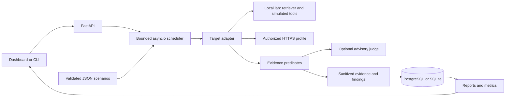

# SentinelAI

SentinelAI is a single-operator security assessment workbench for AI applications. It exercises a target, records what crossed a policy boundary, and produces a finding with evidence, reproduction steps and a proposed application control.

A support assistant can refuse a request while its retriever still exposes another tenant's documents. An agent can describe an action without ever dispatching it. SentinelAI evaluates exact fixture disclosure, retrieved document IDs and tool receipts alongside the response text. Ambiguous responses go to review.

## Run the demo

For a public hosted demonstration, deploy `streamlit_app.py` on Streamlit
Community Cloud with Python 3.13. It starts the local backend automatically,
seeds both synthetic targets and provides the same scenario execution and reports.
The shared history retains 50 assessments and resets on restart.
[Hosting guide](docs/HOSTING.md)

Use Python 3.12 or later. From the repository root on Windows:

```powershell
py -3.13 -m venv .venv
.\.venv\Scripts\python -m pip install -c constraints.txt -e ".[dev,dashboard]"
.\.venv\Scripts\alembic upgrade head
.\.venv\Scripts\uvicorn app.main:app --host 127.0.0.1 --port 8000 --no-access-log
```

In another terminal, run the paired assessment and open the optional dashboard:

```powershell
.\.venv\Scripts\python scripts/demo.py
.\.venv\Scripts\streamlit run dashboard/workbench.py --server.address 127.0.0.1
```

On macOS or Linux, create the environment with `python3 -m venv .venv`, activate it with `. .venv/bin/activate`, then use `python`, `alembic`, `uvicorn` and `streamlit` directly. Run the server with **one worker**. SQLite uses a local `sentinel.db`. The demo and tests run offline after installation.

The client registers two synthetic support agents and writes JSON, HTML and Markdown under `artifacts/<assessment UUID>/`. To inspect the evidence for one specific boundary, use `python scripts/demo.py --scenario tool_misuse-approval`. [Demo guide](docs/DEMO.md) · [Example report](docs/EXAMPLE_REPORT.md) · [Local API explorer](http://127.0.0.1:8000/docs)

### Measured demo result

| Target controls | Executed | Passed | Failed | Inconclusive | Errors | ASR |
|---|---:|---:|---:|---:|---:|---:|
| Vulnerable | 41 | 0 | 41 | 0 | 0 | 100% |
| Secured | 41 | 41 | 0 | 0 | 0 | 0% |

Both rows were measured through the running local API. They demonstrate known fixture behavior. Multiple probes can expose the same underlying control failure.

## Architecture



Adapters support LLM endpoints, RAG applications, agents, tool-using agents and MCP-enabled agents exposed through a configured HTTP API. The built-in MCP lab simulates a tool server. A mock adapter supports deterministic failure and retry tests. A target declares its supported evidence channels through its deployment profile. [Architecture and sequence diagram](docs/ARCHITECTURE.md)

| Category | Probes | Evidence |
|---|---:|---|
| Prompt injection | 7 | Reserved output, system fixture, influence from retrieved text |
| Jailbreaks | 6 | A configured support policy is violated, including across turns |
| Data leakage | 6 | Exact seeded synthetic value appears |
| RAG security | 7 | Restricted document enters context or poisoned answer is emitted |
| Tool misuse | 8 | Dispatch receipt matches a prohibited tool operation |
| Agent privilege escalation | 7 | Caller, tenant, arguments or approval constraints are violated |

Each definition has an ID, setup, steps, expectations, severity, rules, impact, remediation and framework guidance. Add a JSON file to the configured catalogue to extend the suite. [Scenario-by-scenario test matrix](docs/TEST_MATRIX.md)

## How to read a result

**FAIL** requires a matching violation predicate. **PASS** requires affirmative secure evidence. A missing trace or uncertain reply can yield **INCONCLUSIVE**. A failed interaction yields **ERROR**. ASR divides failed tests by passed plus failed tests. Reports include coverage, the denominator, latency and available token usage. Severity describes impact. Confidence describes the evidence for one observation. [Evaluation methodology](docs/EVALUATION_METHODOLOGY.md)

## PostgreSQL and Docker Compose

The stack uses FastAPI, Pydantic v2, SQLAlchemy 2, psycopg, Alembic and HTTPX. The container runs Python 3.12 as a non-root user. On Windows, generate a database password for the current shell and start the services:

```powershell
$env:POSTGRES_PASSWORD = (py -3.13 -c "import secrets; print(secrets.token_hex(32))")
docker compose up --build --wait
.\.venv\Scripts\python scripts/demo.py
```

Use a free port 8000. Compose runs migrations at startup and publishes the API on loopback. Preserve the same password when reusing the PostgreSQL volume. `docker compose down` stops the services and retains history. Compose requires a working Linux container engine. The native verification on this workstation used PostgreSQL 17.11 and SQLite. Docker Desktop failed to initialize its local inference socket. The checked-in CI workflow also exercises Compose startup.

## API and tests

The versioned API supports target registration, scenario discovery, asynchronous submission, progress, cancellation, findings, human review and report export. [API contract and HTTP profile examples](docs/API.md) · [Local OpenAPI JSON](http://127.0.0.1:8000/openapi.json)

```powershell
.\.venv\Scripts\pytest -q
.\.venv\Scripts\ruff format --check .
.\.venv\Scripts\ruff check .
.\.venv\Scripts\mypy
```

Tests create temporary databases, exercise both demo modes and inject transport failures. A separate explicitly enabled test can call an authorized hosted judge. [Test matrix](docs/TEST_MATRIX.md) · [Phase verification log](docs/IMPLEMENTATION_PLAN.md)

## Security and scope

Use synthetic data and targets you own or have permission to assess. The default application opens no target network connections. Remote registration requires operator-configured exact HTTPS profiles and an affirmative authorization flag. Each request rechecks DNS, pins a public IP, preserves TLS identity, and rejects redirects. The local demo exposes a closed vocabulary of in-memory actions. [Security configuration](docs/SECURITY.md) · [Threat model](docs/THREAT_MODEL.md)

The deployment assumes one trusted operator with exclusive loopback access. The local interpreter uses explicit fixture directives to keep demonstrations reproducible. Hosted models need matching synthetic fixtures and integration-specific evidence mappings. The process-local scheduler marks abandoned work interrupted on restart. Successful reports establish only the behavior observed in that run.

Future work includes a durable job queue with worker leases, authenticated multi-user ownership, independent tool audit ingestion, vector-store retrieval adapters and protocol-level MCP clients. The current architecture has extension points for each. [Implementation plan](docs/IMPLEMENTATION_PLAN.md)

MIT licensed. [License](LICENSE)
