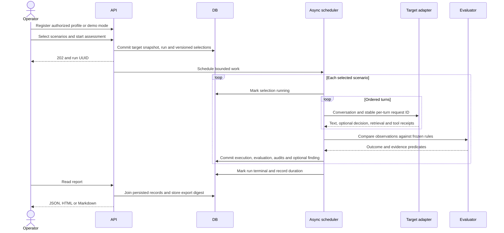

# Architecture

## Execution sequence

## Responsibilities

| Package | Contract |
|---|---|
| `app/attacks` | Validates closed JSON schemas, enforces unique IDs and compiles ordered conversation steps. Modules can be registered by category. |
| `app/targets` | Implements `TargetAdapter.send(Interaction) -> Observation`. HTTP profiles map nested JSON using dot paths. |
| `app/demo` | Owns a scenario-local corpus, tool server, principal and volatile conversation memory. |
| `app/orchestration` | Accepts a selection, checks capabilities, bounds global and per-run concurrency, tracks cancellation and isolates target failures. |
| `app/evaluation` | Checks observations before redaction, projects safe receipts, optionally seeks a structured advisory opinion, computes rates. |
| `app/database` | Defines SQLAlchemy entities, foreign keys, indexes, PostgreSQL JSONB and SQLite JSON. |
| `app/reporting` | Reconstructs reports from committed evidence and definition snapshots. |
| `app/api` | Validates registration and selection, enforces request boundaries and exposes queries and mutations. |

## Storage and transactions

All nine tables have UUID keys and UTC creation timestamps. `targets` holds safe configuration and credential profile references. `assessments` references a target and freezes its settings. `definitions` stores scenario bodies keyed by a unique SHA-256 digest. `assessment_scenarios` maps ordered selections to immutable definition rows. Each selection has at most one `executions` row and one associated `evaluations` row. An execution can create one `findings` row and multiple `tool_audits`. `reports` holds the latest export digest for each assessment and format.

The run and all selections commit together. An execution, its evidence, verdict, finding, audits and terminal selection status commit together. A target referenced by history cannot be deleted. Changing a deployment profile invalidates existing registrations for that profile. Re-register the reviewed endpoint to authorize the new configuration.

## Engineering decisions

* **Declarative attacks.** The same conversation runner can apply a new scenario from disk. Replace the module for a category when it needs a different procedure. Neither runner nor module opens sockets.
* **Isolated fixtures.** Each demo scenario gets a new lab instance. Within a scenario, multi-turn changes to the corpus, memory and simulated tickets persist. Concurrent probes cannot contaminate each other.
* **Bounded worker in the API process.** The API returns after submission. Short synchronous database transactions run in the owner process. Database stalls can delay API requests. A single worker owns scheduling, rate limits and startup recovery. Independent worker processes need a durable queue, locks and leases first.
* **Retries.** Only profiles explicitly marked idempotent can retry transient failures. Each retry uses the same request ID. Wall-clock timeouts cancel the in-flight coroutine. Dispatch to a remote service can outlive client cancellation.
* **Evidence minimization.** The evaluator sees the in-memory response. Persistence receives lengths, fixture matches, typed decisions, projected document IDs and tool receipts. Reproduction uses versioned definitions, target snapshots and configuration fingerprints.
* **Extension points.** Implement the retriever, adapter, attack module or judge protocol for another backend. A protocol-level MCP adapter can normalize trusted server receipts to the current trace schema. Independent audit collection would improve the confidence of remote verdicts.
